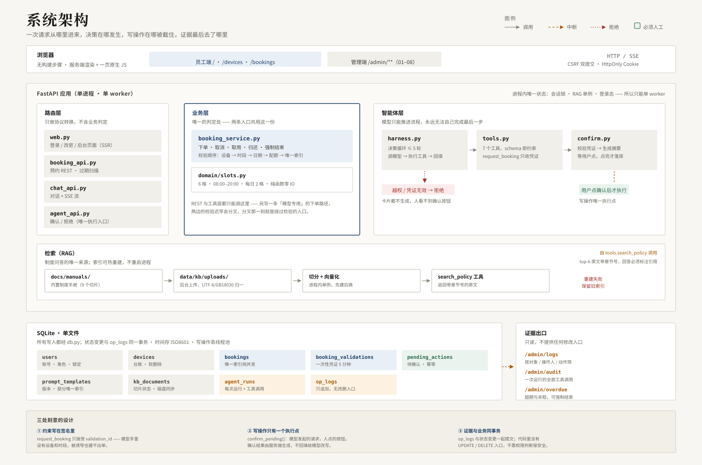
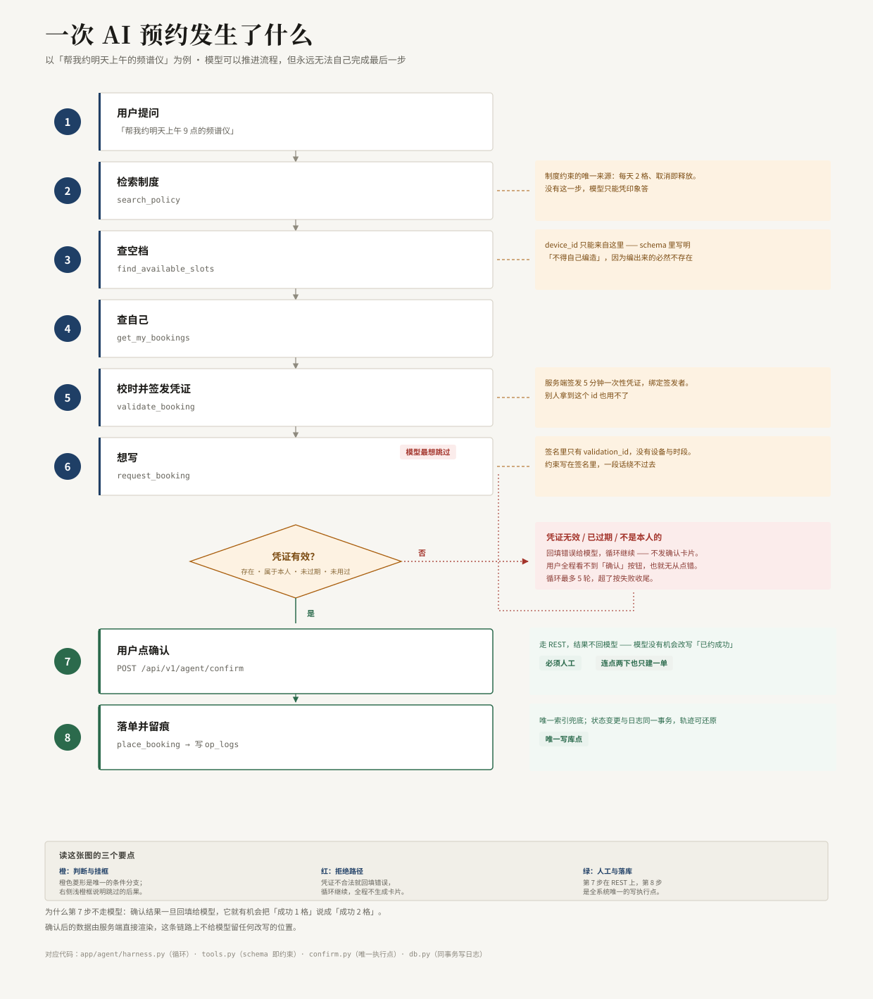
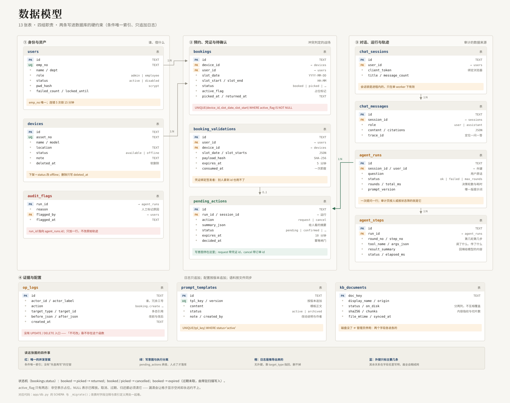

# 共享设备借用与维护

[](https://github.com/liusitong621/SharingDeviceBooking/actions/workflows/ci.yml)

**一个"能自己查、能自己约、但绝不自己动手"的设备借用助手**：员工用一句话查空档、下单、取消；模型自己决定查哪一步、调哪个工具，**所有写操作停在"待确认"，人点了才落库**，每一步决策都留痕可复查。

它回答一个具体问题：*这台设备这个时段到底有没有人占？为什么那一单会被重复预约？模型刚才到底做了什么？*

> 设备、账号与制度文本均为**合成样本**，不含任何真实员工或企业信息。
> 题目来自课程实践《共享设备预约与维护》，**不是上线系统**，未做部署、备份与压测（见[已知边界](#已知边界)）。

---

## 为什么需要它

现状是"群里喊一声 + Excel 记一笔"。麻烦不在流程长，在**对不上**：

| 断点 | 现场表现 | 后果 |
|---|---|---|
| 时间对不上 | 先在群里约，事后再补表 | 表里的时间 ≠ 实际使用时间 |
| 状态对不上 | 设备在维修，系统里还是"可用"，人到现场才发现 | 空跑一趟，还得再约一次 |
| 记录对不上 | 谁约的、取没取、还了没，各处各记一段 | 出现争议时谁都说不清 |

Excel 拦不住并发（两个人同时填同一格），也回答不了"这格凭什么显示空闲"。这个系统把判定收窄成**一条数据库唯一约束 + 一条只追加的轨迹**，并且只让模型"建议"，不让它改数据。

## 它做什么 / 不做什么

| 做 | 不做 |
|---|---|
| 按"日期 × 设备"看 6 格占用：可约 / 我的 / 已约 / 已过 | 不做审批流：提交即生效，免审 |
| 用一句话约、取消、查自己名下的单，模型自己决定查哪一步 | **不让模型直接写库**：写操作一律停在待确认 |
| 同一格只能有一单，靠唯一索引兜底，并发也拦得住 | 不做扫码 / 智能柜，取还是自报的 |
| 设备台账、上下架、超期与未取清单、强制结束 | 不做维护工单 —— 状态只有 `available / borrowed / offline` |
| 每次状态变更写 `op_logs`，每次提问写 `agent_runs` | 日志只追加，**没有删除入口**（不是靠权限判断，是靠不存在这个函数） |
| 改制度、改提示词都不用重启，发布即生效 | 不做费用、信用、赔偿 |
| 上传制度 `.md` / `.txt`，立即重建索引 | 不解析 PDF：拆表会丢关键数字，宁可要求先转 markdown |
| 员工端与管理端两套入口，登录页就分开 | 不做 SSO / HR 同步，账号靠 CSV 批量导入 |

## 已知边界

先说清楚它哪里不够好，比后面所有功能都重要。

| 限制 | 影响 | 什么时候必须解决 |
|---|---|---|
| 会话锁、登录限流、检索索引**都在进程内** | 只能单 worker 跑 | 要横向扩容时（索引需外置到 pgvector） |
| 智能体**最终回答是非流式的** | 首字延迟 = 生成完毕，约 2–4 秒 | 演示需要"边想边说"的观感时 |
| 未配 embedding 接口时用本地哈希向量 | 只捕捉字面重合，语义检索接近于无 | 要问"制度里没明说"的问题时 |
| 待确认动作靠 `expires_at` 惰性过期 | 没有定时清理，`pending_actions` 会慢慢长 | 累计上万条前 |
| 上传只支持 `.md` / `.txt`，单文件 512KB | 制度原文得先转 markdown | 制度只有 PDF 时 |
| 取还是**用户自报**的 | 争议时只能靠时间戳，证明不了物理事实 | 要追责"设备到底在不在柜里" |
| 单日 2 格上限、当前时段不可约、停用不自动释放占用 | 三处口径是我按最简方案定的 | 真实试点前需与管理层确认（见[需求追溯](./docs/需求追溯.md)附录 B） |
| 未做 Docker、备份、压测 | 只有 `uvicorn` 单进程；`data/chat.db` 删了会重新 seed | 要交给别人运维时 |

技术原因分别写在[设计取舍](#设计取舍为什么这么做)各节。

## 60 秒上手

Python 3.11+。依赖全部锁定在 `requirements.txt`：

```bash
git clone <repo-url> && cd SharingDeviceBooking
python -m venv .venv
.venv/bin/pip install -r requirements.txt
.venv/bin/uvicorn app.main:app --port 8000
```

打开 <http://127.0.0.1:8000> → 自动跳登录页。演示账号（**首次登录强制改密**）：

| 工号 | 密码 | 角色 | 进哪一端 |
|---|---|---|---|
| `admin` | `Admin@12345` | 管理员 | `/admin/login` |
| `1001` | `Staff@12345` | 员工 | `/login` |
| `1002` | `Staff@12345` | 员工 | `/login` |

跑一遍自检（不需要启动服务，也不用配模型）：

```bash
./scripts/verify.sh      # 130 项单测 + R01–R08 逐条工具侧核对，有失败返回非零
```

看它真的能跑（临时库，不碰 `data/chat.db`，跑完不留痕）：

```bash
.venv/bin/python examples/demo.py
```

它走完七幕：查空档 → 校验拿凭证 → 模型被拦 → 用户点确认 → 连点幂等 → 越权被拒 → 取消释放 → 审计还原。
**全程不调用大模型**——它演示的是约束在哪里，不是模型有多聪明；装了模型之后同样的路径由模型驱动，边界一条不变。

想要一个「已经跑过三周」的库，灌一份自洽的演示数据：

```bash
./scripts/demo_reset.sh           # 先备份 data/chat.db，再写入（幂等，重复执行不会叠加）
./scripts/demo_reset.sh --fresh   # 备份后从空库重建
./scripts/demo_reset.sh --dry-run # 只打印计划，不写库
```

写进去的不是一堆随机数字，而是彼此对得上的记录：12 台设备、10 个员工、76 张预约单、
197 条留痕、15 轮智能体轨迹、3 个提示词版本、4 条审计标记。点开任意一张单，
它的状态变化在日志里能逐条还原；点开任意一条审计，回答里提到的设备和时段就是库里那一行；
设备标着「借出中」，超期页就一定有对应的「已取未还」。

其中一条「待确认」特意留成未决（对话审计里 `1006` 那条恒温恒湿箱），
现场点确认会真的落一张单——这是唯一一条为演示放宽了凭证有效期的数据，脚本注释里写明了原因。

> 晚上执行时概览页「今日预约」显示 0 格是对的：今天的 6 格都结束了。填充数据落在过去两周与未来三天。

> **不配模型也能完整演示界面**：没有 `LLM_API_KEY` 时自动降级为「检索 + 原文直出」，不白屏、不伪造回答。
> 但**降级模式不会走智能体循环**（没有模型就没有决策），也就看不到确认卡片。
> 想看完整的决策与中断链路，配一个支持 Function Calling 的模型：
>
> ```bash
> export LLM_PROVIDER=qwen        # openai / deepseek / qwen / ollama
> export LLM_API_KEY=sk-xxx
> export LLM_MODEL=qwen-plus
> export JWT_SECRET=...           # 不设会自动生成并落盘到 data/.jwt_secret
> ```
>
> 或者直接跑 `test_sse_interrupt_frames` —— 它用脚本化假模型跑通了同一条链路，不花钱。

## 系统结构



<sub>图是矢量的，点开看原图更清楚；PPT 里可直接用，放大不失真。</sub>

四层职责可以对着图直接讲：

- **路由层**只做协议转换，不含业务判定；
- **业务层**是唯一的判定处 —— REST 与工具层都只能调它，另写一条"模型专用"的下单路径，两边的校验迟早会分叉；
- **智能体层**负责决策，但写操作一律在 `confirm.py` 前停下，等人在 REST 上点确认；
- **存储层**用一条条件唯一索引兜住并发，用只追加的 `op_logs` 记录轨迹。

RAG 不算一层：它是被 `search_policy` 调用的工具依赖，所以画在下方并用文字标注调用关系，避免误读成"请求必经检索"。

## 需求覆盖（R01–R08）

对照 [`docs/一页纸需求清单-MVP-v1.md`](./docs/一页纸需求清单-MVP-v1.md) 的验收口径。
逐条的实现位置、测试名、可核对证据、**没做到的部分**见 [`docs/需求追溯.md`](./docs/需求追溯.md)。

| 编号 | 需求 | 落点 | 状态 |
|---|---|---|---|
| R01 | 设备台账与状态 | `/admin/devices`（增删改 + 上下架，软删除） | 已实现，缺"维修中"维度 |
| R02 | 日期 × 设备的 6 格占用视图 | `/devices`（含「我的」态） | 已实现，当前时段不显示 |
| R03 | 预约冲突拦截 | 唯一索引 + 409 | 已实现，8 并发自检；未做 50 并发压测 |
| R04 | 取消即释放 | `active_flag = NULL` | 已实现 |
| R05 | 取还登记 | `/bookings`（归还填实际时间与状况） | 已实现，取还自报 |
| R06 | 超期与未取清单 | `/admin/overdue` + 强制结束 | 已实现，无提醒 |
| R07 | 操作留痕 | `op_logs`，与业务变更同事务 | 已实现，不可外部稽核 |
| R08 | 账号导入与停用 | `/admin/users` | 已实现，停用不释放占用 |

**R07 的三条硬约束**（这三条决定它能不能当证据用）：

1. **日志与业务变更同一个事务**——先改状态再另开连接写日志，中间崩了就会出现"预约没了、日志也没有"，而这恰恰是最需要日志的时刻。
2. **没有 UPDATE / DELETE 入口**——"日志不可被删"靠"不存在这个函数"保证，比靠权限判断可靠。
3. **系统动作标明来源**——过期扫描记 `system:expire_worker`，不伪装成人的操作。

## 一次 AI 预约发生了什么

模型不是"一问一答"，是一条带闸门的循环。以「帮我约明天上午 9 点的频谱仪」为例：

```
用户提问
  → 检索制度（search_policy）          拿到"每天最多 2 格"等约束
  → 查空档（find_available_slots）      拿到 device_id
  → 查自己（get_my_bookings）           已约几格，是否超限
  → 校时（validate_booking）            服务端签发 5 分钟一次性凭证
  → 想写（request_booking）             ← 只有凭证，没有设备与时段
        ├─ 凭证无效 → 回填错误，循环继续，**不发卡片**
        └─ 凭证有效 → 落 pending_actions，循环结束，发 confirm_required
                          ↓
                     用户点"确认"
                          ↓
              POST /api/v1/agent/confirm（REST，不回到模型）
                          ↓
                    place_booking（唯一索引兜底）→ 写 op_logs
```



**关键设计**：中断之后，执行确认的必须是 REST 路径，**永远不回模型**。这一条决定了后面"为什么自研 harness"的取舍。

## 智能体编排

### 为什么是自研 harness，而不是 LangGraph

`harness` 不是可安装的框架，是"模型外层运行循环"这个模式的通称。三个真实选项：

| 选项 | 优势 | 本项目的取舍 |
|---|---|---|
| LangGraph | 图调度、checkpoint 持久化、原生 `interrupt()` | 会重写现有 SSE 链路；本项目 7 个工具一条主干 |
| OpenAI Agents SDK | 开箱即用 | 绑定 OpenAI 协议，与"可换供应商"冲突 |
| **自研薄 harness** | 约 400 行、零新依赖、与现有 409 / 幂等 / 唯一索引完全对齐 | 选它 |

决定性理由：**中断之后，执行确认的必须是 REST 路径，不能回到模型。**
图框架的 `resume` 语义是"从断点继续跑图"，而这里要的恰恰是"永远不要继续跑图"——用框架反而要和它的设计意图对抗。

### 7 个工具

| 工具 | 类型 | 参数 | 说明 |
|---|---|---|---|
| `search_policy` | 读 | `query` | 制度检索，返回带编号的片段（编号与引用卡片一一对应） |
| `find_available_slots` | 读 | `date?`, `asset_no?` | 查某天空闲格，返回 `device_id` 供后续使用 |
| `get_device_info` | 读 | `asset_no` | 设备状态、位置、型号 |
| `get_my_bookings` | 读 | `status?` | 只能查到本人名下的单 |
| `validate_booking` | 校验 | `device_id`, `slot_date`, `slot_starts` | 通过后签发 5 分钟一次性凭证 |
| `request_booking` | **写** | **仅 `validation_id`** | 被中断，转成待确认 |
| `cancel_booking` | **写** | `booking_id` | 同样被中断 |

### 顺序约束写在签名里，不写在提示词里

`request_booking` **不接受设备和时段**，唯一参数是 `validation_id`。
即使模型被"别废话直接约"诱导、或提示词被注入，它手里也没有凭证，调用必然失败。
约束写在签名里，就不可能被一段话绕过。

四道闸门，每一道都能独立挡住双单：

1. **签名**：没有凭证就调不了；
2. **待确认动作的原子 claim**（`WHERE status='pending'`）：连点两下只有一次生效；
3. **凭证的原子 consume**：同一张凭证用第二次返回空；
4. **唯一索引**：并发抢同一格，数据库兜底。

### 日志表（阶段 5 的数据源）

- `agent_runs`：一次提问 = 一行。`status` 区分 `answered` / `awaiting_confirm` / `max_rounds` / `failed`。
  其中 `awaiting_confirm` 是最有价值的信号——它直接反映模型对写操作的冲动程度。
- `agent_steps`：一次工具调用 = 一行。`status` 区分 `ok` / `error` / `interrupted` / `skipped`。
- `pending_actions`：模型的写意图。它把"模型想做什么"和"系统做了什么"在数据上彻底分开。

## 设计取舍：为什么这么做

### 同一格只能有一单：靠索引，不靠判断

```sql
CREATE UNIQUE INDEX uq_booking_slot ON bookings(device_id, slot_date, slot_start, active_flag);
```

- 下单只有一条路径：直接 `INSERT`，捕获 `IntegrityError` 转 409。**禁止"先 SELECT 判空再 INSERT"**（TOCTOU 竞态，并发下必然双单）。
- 取消时 `active_flag = NULL`。唯一索引不约束含 NULL 的行，所以这个格子立刻可被重约，无需把取消记录搬到归档表。
- 时段边界由 `app/domain/slots.py` 的纯函数保证，时间由参数注入。含一条容易做错的规则：**时段一开始就不能再被预约**（10:17 时 10:00–12:00 已不可约），否则用户会约到半格，且可能与现场使用者冲突。

### 提示词为什么进数据库

提示词从 `app/agent/prompts.py` 的常量变成了"数据库里有版本的数据"，三条设计决定：

1. **追加版本，不原地改。** 保存一次插一行新版本，旧行转 `archived`。
   原地 UPDATE 就永远回答不了"上周回答变差是不是因为改了提示词"——而那是唯一值得追问的问题。
2. **每个 key 至多一个启用版本，交给数据库。**
   `CREATE UNIQUE INDEX ... ON prompt_templates(tpl_key) WHERE status='active'`
   与 `bookings.active_flag` 同一手法：应用层"先查再改"在并发下会写出两个启用版本，数据库不会。
3. **内容不进 `op_logs`。** 日志记"谁发布了 v7、说明是什么"，全文留给模板表按版本查。
   否则日志页会变成一面文字墙，而审计真正要看的是变更点。

**回滚不是撤销**：回滚到 v3 实际是"用 v3 的内容发布一个新版本"。
版本号只增不减，所以"v9 是回滚 v3 得到的"永远成立；直接让 v3 重新 active，会让"当前是 v3"和"最新是 v9"同时为真，中间几次修改算不算数就说不清了。

**占位符校验分两档**：未知占位符（如 `{max_slot}`）是**错误**，拦保存——它不会被替换，会原样出现在模型眼前，而页面显示"保存成功"，属于静默污染。缺 `{today_hint}` 只是**警告**，渲染时自动追加到末尾，功能不坏，不值得为排版拦住人。

**模板坏了不等于服务不可用**：读库失败、内容非法（多半是直接改库）都回落内置模板，只写一条 error 日志。助手答得差一点，好过整站 500。每轮对话把实际用的版本号记在 `agent_runs.prompt_version`（NULL = 内置）。

### 制度改了为什么不用重启

此前 `rag.warmup()` 只在进程启动时跑一次，`_kb` 一旦有值就再也不刷新：管理员改了制度文件，用户问到的还是旧条文，**除非重启服务**。制度每年都要改，这是唯一"业务上必然发生"的场景。

**语料留在磁盘上，只有元数据进库。** `docs/manuals/`（内置，随代码走 git）与 `data/kb/uploads/`（后台上传）两个来源合并成一套索引；`kb_documents` 只登记文件名、来源、启停状态、切片数，**不存正文**。

> 为什么不把切片存进数据库：制度文件要归档、盖章、交接，文件本身必须是唯一真相。切成 500 字片段存库，等于把"制度原文"降级成"检索片段"，日后要证明"当时那句原文是什么"就得从碎片里拼回去。

**重建是先建后换，不是先清后建。** 整段在锁内跑，但 `_kb` 的赋值在最后一步：重建期间进来的检索继续用旧索引，看不到"建到一半"的状态；重建失败则保留旧索引，只是新内容检索不到。字典/制度写坏了，不该让问答整个挂掉。

**停用，而不是删除。** 制度作废时正确动作是"不再被命中"，不是销毁原件——原件与切片规则都还在，一年后要追溯"当时为什么这么答"还能复现。删除只对上传文件开放（文件移到 `data/kb/.trash`，不是 unlink）；内置文档只能停用，否则网页上删掉会和 git 仓库产生静默分歧。

**`on_disk` 与 `status` 拆成两列**：前者是事实（文件在不在，每次扫描刷新），后者是人的决定。合成一列，一次误删就会把"管理员主动停用"覆盖成"文件丢失"，两种完全不同的处置理由被抹平。

**编码在入口处归一到 UTF-8。** 企业里大量制度是 Windows 上另存的 GBK，让人先去转码，实际结果是他把文件丢进聊天框说"你帮我弄一下"。上传时解码、统一存 UTF-8。

### 审计该记什么、不该记什么

这一页回答的不是"系统跑得好不好"，而是三个具体到人的问题：

1. **谁在什么时候问了什么**——追责的起点；
2. **模型有没有试图写库，人最后点没点确认**——审计的核心，不是聊天记录；
3. **出问题那句话，模型调了什么工具、拿到什么回执**——复盘依据。

所以查询一律从 `agent_runs` 出发，不从 `chat_messages`：聊天记录只说明"说了什么"，说明不了"做了什么"。

| | 记什么 | 给谁用 |
|---|---|---|
| `op_logs` | **人**对系统做了什么（谁取消了谁的预约） | 追责 |
| `agent_runs` / `agent_steps` | **模型**对系统做了什么（调了什么工具、有没有被拦下） | 复盘 |

合并成一张表，两边都会被对方的噪音淹没。

**写意图单独一块**，因为它才是审计的核心问题。`agent_steps` 只能说明"模型想写"，`pending_actions.status` 才能说明"最后写成了没有"——`confirmed` 才算落地，`rejected` / `expired` / `failed` 都是没落地。

**标记是人的批注，不是数据修改**。`audit_flags` 单独一张表，主键是 `run_id`：`agent_runs` 是机器产生的事实，写进去就不该再改；标记会改、会撤、会换理由。混在一张表里，以后就没法回答"这行到底哪些是当时的原始数据"。撤销标记同样进 `op_logs`（`audit.unflag`）——"谁把标记去掉了"值得追问。

## 数据模型



需求清单的原话是"**4 张表，不许多**"（`users` / `devices` / `bookings` / `op_logs`），最后落了 **13 张**。
多出来的九张不是膨胀——每一张都能指到一条具体约束：

| 新增的表 | 哪条约束逼出来的 |
|---|---|
| `booking_validations` | 模型不能自己下单 → 它必须先拿一张一次性凭证 |
| `pending_actions` | 写操作必须等人确认 → 意图要有地方停、要能幂等 |
| `agent_runs` | AI 的行为要能被复查 → 每次提问一行，记轮数与耗时 |
| `agent_steps` | 只记"跑过"不够 → 每次工具调用的参数与回填都要留 |
| `audit_flags` | 标记会改、会撤、会换理由，不能和机器事实混在一张表 |
| `chat_sessions` | 对话要能按人检索（审计要求），且要绑定浏览器 |
| `chat_messages` | 回答与引用要能回看，`trace_id` 用来定位一问一答 |
| `prompt_templates` | 改提示词不能靠改代码重启 → 按版本追加 + 部分唯一索引 |
| `kb_documents` | 制度文件要能停用、能重建索引 → 记录切片状态与磁盘同步 |

`op_logs` 是原始四张之一，但形态变了：`actor_label` 冗余存工号（人删了日志仍然可读），
`before` / `after` 改成 JSON（不同对象的字段不一样，开列会开不完）。

两条约束写进了数据库而不是应用层：

1. **`bookings` 上带条件的唯一索引** —— `UNIQUE(device_id, slot_date, slot_start) WHERE active_flag IS NOT NULL`。两个人同时抢同一格，数据库只放行一个；代码里不存在"先查再写"的空窗。
2. **`op_logs` 没有 UPDATE / DELETE 入口** —— "日志不可改"靠"没有这个函数"保证，不靠权限判断。

## 核心接口

| 方法 | 路径 | 说明 |
|---|---|---|
| POST | `/api/v1/chat` | 流式问答（需登录），智能体循环 |
| POST | `/api/v1/agent/confirm` | **确认/拒绝待确认动作**（写操作的唯一执行入口） |
| GET | `/api/v1/agent/pending/{id}` | 查待确认动作状态（刷新页面后判断卡片是否还可点） |
| GET | `/api/v1/devices?date=` | 设备列表 + 当日可用格数 |
| GET | `/api/v1/devices/{id}/slots?date=` | 某设备某天 6 格状态 |
| POST | `/api/v1/bookings` | 创建预约，冲突 409（页面直接下单走这条） |
| GET | `/api/v1/bookings/mine` | 我的预约 |
| POST | `/api/v1/bookings/{id}/cancel` | 取消 |
| POST | `/api/v1/admin/devices/{id}/status` | 上下架（管理员） |
| GET | `/api/v1/auth/me` | 当前用户 |

页面路由（服务端渲染，非 API）：

| 方法 | 路径 | 说明 |
|---|---|---|
| GET | `/devices?date=` | 员工占用视图，点空格直接下单 |
| POST | `/bookings/new` | 视图上下单（表单，落 `place_booking` 同一写入口） |
| GET | `/admin/overdue` | 超期与未取三清单 |
| POST | `/admin/bookings/{id}/force-close` | 强制结束（管理员） |
| GET/POST | `/admin/devices` | 台账列表 / 新增 / 编辑 / 删除 |
| GET/POST | `/admin/users` | 账号列表 / 导入 / 停用 / 重置密码 |
| GET | `/admin/logs` | 操作日志查询（可按 `target_id` 查单条轨迹） |
| GET | `/admin/prompts` | 提示词模板清单 |
| GET/POST | `/admin/prompts/{key}` | 编辑 / 预览 / 发布 / 回滚 |
| GET | `/admin/policies` | 制度知识库列表 / 索引状态 / 切片预览（`?preview=<doc_key>`） |
| POST | `/admin/policies/upload` | 上传 md/txt 并立即重建索引 |
| POST | `/admin/policies/status` | 启用 / 停用某份制度（停用即退出检索） |
| POST | `/admin/policies/delete` | 删除上传的制度（文件移到 `data/kb/.trash`） |
| POST | `/admin/policies/rebuild` | 按磁盘现状重建索引（改了文件不用重启） |
| GET | `/admin/audit` | 对话审计列表（按员工 / 状态 / 日期 / 标记筛选） |
| GET | `/admin/audit/{run_id}` | 单次对话详情：工具轨迹、写意图结局、会话上下文 |
| POST | `/admin/audit/{run_id}/flag` | 标记 / 撤销「需要跟进」 |

## 测试

```bash
./scripts/verify.sh                                   # 推荐：单测 + 需求核对
.venv/bin/python -m unittest discover -s tests -q     # 只跑单测
```

`scripts/verify.py` 在单测之外，按 R01–R08 各跑一条端到端断言：台账编号唯一与删除约束、
视图与拒单同源（下架整列锁死且 API 同拒）、并发抢同一格、取消后他人能立即约、
未取走自动过期、两张超期清单各命中一条且处置留痕、日志轨迹完整、越权取消被拒……
输出一张 PASS/FAIL 表。**编号与本文件的需求表、`docs/需求追溯.md` 用的是同一套**，
按编号能直接检索到检查代码，不必读完整份脚本。

> **它输出的 PASS 只代表工具侧可核对，不代表业务验收通过。**
> 比如 R03 的 PASS 是"8 个并发只成了 1 单"，它证明不了"50 人同时抢也不出问题"——那需要压测。

**130 个用例**，分六组：

| 文件 | 数量 | 覆盖什么 |
|---|---|---|
| `test_slots.py` | 16 | 时段生成、边界相接、窗口期、四态优先级（纯函数，时间注入） |
| `test_harness.py` | 15 | 循环、中断、确认、SSE 帧（脚本化假模型，不花钱） |
| `test_batch2.py` | 35 | 占用视图四态、名单解析、日志摘要，以及**用临时库**跑的状态机不变量 |
| `test_batch3.py` | 25 | 占位符解析与校验、渲染、版本自增与归档、回滚追加、**模板坏了回落内置** |
| `test_batch4.py` | 21 | 审计筛选（含"日期到当天"的差一天回归）、状态统计、标记不改动原始轨迹 |
| `test_batch5.py` | 18 | 文件名清洗、编码归一、**停用后切片真的消失**、**重建失败保留旧索引**、`on_disk` 与 `status` 不被互相覆盖 |

测试优先覆盖"容易在改代码时悄悄坏掉"的地方，而不是覆盖率数字。几个典型的回归用例：

- `test_return_releases_slot`：归还后必须清 `active_flag`。少写这一句，格子显示空闲但提交 409，**永久不可再约**（开发中真实踩过）。
- `test_rebuild_failure_keeps_previous_index`：索引重建失败时保留旧索引。否则一份写坏的制度文件就能让问答整个挂掉。
- `test_date_to_includes_whole_day`：`to=2026-11-05` 要包含 11-05 全天。字符串比较会让当天记录全部消失。

## 界面

两套壳，不是一个导航里混排：员工只有三个动作，管理员要管六类对象。

| | 员工端 | 管理端 |
|---|---|---|
| 入口 | `/` `/devices` `/bookings` | `/admin/**` |
| 布局 | 顶部品牌条 + 横向三 tab | 左侧编号目录 01–08 |
| 登录页 | `/login` 浅色单卡 + 员工端顶栏 | `/admin/login` 深色双栏 + 后台目录墙 |
| 模板 / 样式 | `templates/user_base.html` / `static/user.css` | `templates/base.html` / `static/admin.css` |

四件事保证它不是"只换了张皮"：

1. **权限只有一套。** `/admin/**` 全部过 `require_admin`，员工手输 URL 得到 403 页面，不是"菜单藏起来"。登录按角色分流。
2. **组件只有一套。** `user.css` 只有顶部条、导航条、内容容器和一个跳转链接；卡片、按钮、表格、徽章全部来自 `admin.css`。
3. **两个出口互相可达。** 管理端目录下方有「切换到员工端」，员工端顶部条对管理员显示「管理端 →」。
4. **登录入口也分开，而且管理端会拒绝员工。** `/admin/login` 认证成功后还要判角色，非管理员**不下发会话**（不是"先登进去再提示没权限"）；退出按 Referer 回到刚才那一端；登录落点只接受站内路径（`_safe_next()`，挡 `next=//evil.com`）。

样式是一套令牌贯穿两端（`static/*.css` 的 `:root`）：暖纸底 `#f4f2ed` + 三级墨色（对纸白 16 / 9 / 6.9 比 1）+ 全站唯一强调色藏青 `#1f3f66` + 宋体标题 + 2–3px 圆角 + 1px 发丝线。**不用渐变、不用投影堆层级**——正式感来自字形和结构线。

## 语料

- 内置手册放 `docs/manuals/`，**不要**和调研报告混在一个索引里——实测 223 个调研切片会把规程文档挤出 top3。
- 后台上传的制度落在 `data/kb/uploads/`（不进 git），删除的文件移到 `data/kb/.trash/`。
- 目录可用 `RAG_DOCS_DIR` / `RAG_UPLOAD_DIR` / `RAG_PATTERN` 覆盖；改了磁盘上的文件之后，到 `/admin/policies` 点一次「重建索引」即可，**不用重启进程**。

检索效果有评测集，不是凭感觉：

```bash
.venv/bin/python scripts/eval_rag.py                          # 20 条问题 × 三路配置
.venv/bin/python scripts/eval_rag.py --md docs/检索评测.md     # 重新生成报告
```

问题分三档——字面（问句里就带制度原文的词）、口语（员工嘴里的说法）、跨章（答案分两处）。
当前（本地哈希后端）BM25 与混合的 Hit@3 都是 **85%**，字面档 100%、口语档 50%。
差的 3 条全部是「问题里的词在制度里根本不存在」：「退掉」对「取消」、「修」对「维修」、
「占着格子」对「超期未取」。这正好指出了关键词检索的边界，也是配真实 embedding 后该被救回的部分。
详见 [`docs/检索评测.md`](./docs/检索评测.md)——**报告由脚本生成，改完参数重跑就能看到涨跌**。

## 数据与合规

- `data/` 下全部为**合成样本**：3 台虚构设备、3 个虚构账号，制度文本为自撰，不对应任何真实企业。
- 系统不向外部发送任何消息（无邮件、短信、IM），不连接任何生产库；唯一的出网请求是配置后的模型接口。
- 密码用标准库 `hashlib.scrypt` 哈希，日志写入前剥离 `pwd_hash`（有回归用例守着）。
- 若换成真实数据，需要先确认授权范围、保存期限与审计取证要求——当前实现**不满足**（见[已知边界](#已知边界)）。

## 目录

```
app/
  main.py              应用装配、启动预热索引、起过期扫描任务
  errors.py            错误码表与异常处理器
  auth.py              密码哈希、JWT、CSRF、权限依赖
  db.py                SQLite：用户/会话/设备/预约/校验凭证/智能体轨迹
  domain/slots.py      时段规则（纯函数，可单测）
  booking_service.py   预约业务逻辑（REST 与工具层共用）
  booking_api.py       预约 REST + 过期扫描
  chat_api.py          聊天路由与编排（有模型走智能体，无模型走降级）
  agent_api.py         确认接口（写操作的唯一执行入口）
  web.py               登录/改密/后台页面（Jinja2 服务端渲染）
  agent/
    tools.py           7 个工具：schema + 执行 + 注册表（write 打 side_effect 标记）
    harness.py         执行循环：决策 → 执行 → 回填，最多 5 轮，写操作前中断
    confirm.py         待确认动作的准备与执行（唯一碰 place_booking 的地方）
    prompts.py         系统提示词：内置模板 + 入库加载 + 占位符校验与渲染
  seed.py              首次启动的种子账号与设备
  sse.py / llm.py
  rag.py               检索装配层：两路语料合并、可热重建的索引单例、上传清洗
templates/             管理端 base.html + 员工端 user_base.html + 各页面模板
static/                聊天界面（index.html + app.js）、后台样式 admin.css、员工端壳 user.css
docs/
  README.md                 文档索引：十份文件按什么顺序读，各回答什么问题
  discovery-report.md       业务发现报告：现状访谈、分角色证据、**证据缺口**
  同行方案-共享设备预约与维护.md  6 个开源案例对比 + 按需求映射
  现状流程图.png            As-Is 流程：一次借用现在要经过谁
  一页纸需求清单-MVP-v1.md   R01–R08 与验收口径（需求基线）
  需求追溯.md               每条需求的实现位置、测试、证据与未完成项
  architecture.svg          系统架构：四层职责 + RAG 与审计的插入点
  sequence.svg              一次 AI 预约的 8 步（竖排，可直接贴 PPT）
  er.svg                    13 张表的分组、关键约束与主要关系
  检索评测.md               20 条问题 × 三路配置的 Recall/MRR，由脚本生成
  manuals/                  设备借用制度（RAG 语料）
tests/                 6 个测试文件，130 项
scripts/
  verify.sh            自检入口（找 .venv 的 python，转调 verify.py）
  verify.py            130 项单测 + R01–R08 工具侧核对，输出 PASS/FAIL 表
  stage1_rag_prototype.py   阶段 1 单文件原型（检索核心模块唯一定义处）
  eval_rag.py          检索评测：20 条问题 × BM25 / 向量 / 融合，出 Hit@1/3 与 MRR
examples/
  demo.py              端到端演示：七幕跑完一条 AI 预约的完整闭环（临时库，不接模型）
requirements.txt       锁定版本的运行依赖
```
