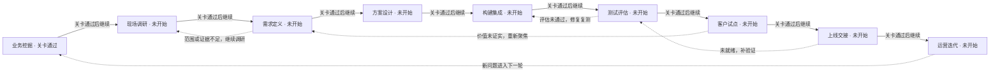
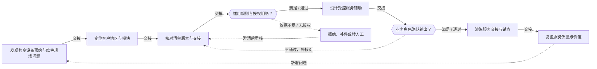
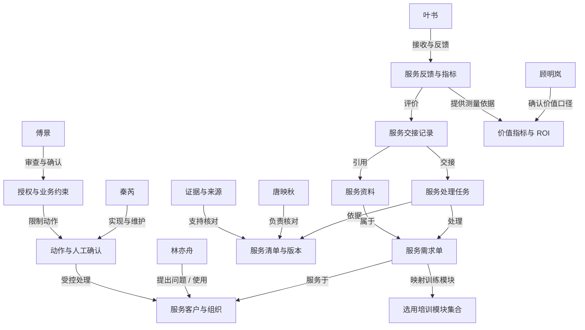

# 共享设备预约与维护 · 项目练习 1

## 当前实践模块

- 共享设备预约与维护（research-equipment）

## 项目可选模块

- 共享设备预约与维护（research-equipment）

## 模块已访谈证据（待核实）

- [research-equipment / research-equipment-f00] 顾明岚：有效使用率 51%，目标 68%；爽约率 16%，目标 6%
- [research-equipment / research-equipment-f02] 顾明岚：选 3 台光谱设备试点，冲突预约为零，有效使用率提高 10 个百分点
- [research-equipment / research-equipment-f05] 顾明岚：预约建议与冲突提醒，不自动启动仪器或改变标定参数。首期采用历史资料回放，再做小范围并行试点，不直接替换现有业务。
- [research-equipment / research-equipment-f01] 顾明岚：当前主流程是：预约 → 资质校验 → 仪器预热 → 使用记录 → 清洁确认 → 结算。管理层还没有分别量出每个节点的等待和处理时间。
- [research-equipment / research-equipment-f04] 顾明岚：立项由实验平台主任推动；实验质控负责人可以因关键风险否决上线，课题组代表参与服务结果验收。
- [research-equipment / research-equipment-f03] 顾明岚：首期可用预算 8 万元，包含集成、培训与验证。收益要扣除维护及人工复核成本，不能把全部节省工时当作现金回款。
- [research-equipment / research-equipment-f10] 林亦舟：预约满了但实际没人用，短实验没有合适的时间槽
- [research-equipment / research-equipment-f12] 林亦舟：每月 900 次预约，操作员每周花 8 小时协调时间
- [research-equipment / research-equipment-f11] 林亦舟：激光器维护结束后仍需标定，却被误标为可预约
- [research-equipment / research-equipment-f15] 林亦舟：建议必须显示对应原记录和待确认字段。发生“激光器维护结束后仍需标定，却被误标为可预约”时，我会暂停该建议，由预约管理员核对后继续，错误结果不能覆盖原记录。
- [research-equipment / research-equipment-f13] 林亦舟：现场执行围绕“共享设备预约与维护”。高峰期只能使用现有终端，离开业务现场去补录会延误处理；草稿应可暂存，并明确最后同步时间。
- [research-equipment / research-equipment-f14] 林亦舟：因为“预约满了但实际没人用，短实验没有合适的时间槽”，同事经常把关键说明留在个人便签或群里，再补进正式记录；这些说明目前没有随单据交接。
- [research-equipment / research-equipment-f20] 唐映秋：预约 → 资质校验 → 仪器预热 → 使用记录 → 清洁确认 → 结算。我负责把每一步的输入、输出和待办责任人写清楚；退回原步骤必须保留原因。
- [research-equipment / research-equipment-f21] 唐映秋：仪器维护日志、使用资质、预热时长与历史预约
- [research-equipment / research-equipment-f22] 唐映秋：我的岗位是预约管理员，可以整理、校核和发起复核；不能代替实验质控负责人完成专业签核，也不能自行批准“预约建议与冲突提醒，不自动启动仪器或改变标定参数”以外操作。
- [research-equipment / research-equipment-f24] 唐映秋：与“共享设备预约与维护”相关规则由业务负责人维护，按生效日期和适用范围选版本。规则冲突时附两个版本给实验质控负责人，不自行合并或选较宽松条款。
- [research-equipment / research-equipment-f23] 唐映秋：交接至少包含业务编号、当前版本、处理状态、未解决事项和接手人。对方确认接手才结束本岗待办，仅发送消息不算完成。
- [research-equipment / research-equipment-f25] 唐映秋：异常先由预约管理员分派给实际处理人；超过约定时限再升级到实验平台主任。跨岗问题不能只写“已转交”，需要明确下一责任人。
- [research-equipment / research-equipment-f30] 秦芮：我们正在使用仪器预约系统和本地设备管理台账，各系统账号权限独立维护，业务状态尚没有统一视图。
- [research-equipment / research-equipment-f33] 秦芮：先校验“仪器维护日志、使用资质、预热时长与历史预约”里的主编号、事件时间和版本字段。预约时长包含预热而使用日志不包含，利用率不能直接比较；有歧义的记录进入人工修复队列，不进入自动推荐样本。
- [research-equipment / research-equipment-f31] 秦芮：预约时长包含预热而使用日志不包含，利用率不能直接比较
- [research-equipment / research-equipment-f35] 秦芮：接口中断时继续使用带时间戳的上一份只读快照，并显示“暂未更新”。重连后按业务编号去重补齐，不反复触发同一待办；现有人工流程继续运行。
- [research-equipment / research-equipment-f32] 秦芮：只读预约和维护状态，设备控制接口不开放
- [research-equipment / research-equipment-f34] 秦芮：本次试点计划每小时更新已授权的业务状态，原始资料按版本更新；信息超过一个更新周期就标为待刷新，不能作为实时承诺。
- [research-equipment / research-equipment-f40] 傅景：未培训人员不能上机，维护与标定阶段不可安排实验
- [research-equipment / research-equipment-f41] 傅景：只有授权的业务岗位可以查看“仪器维护日志、使用资质、预热时长与历史预约”。涉及最终决定、对外承诺或资产变更，要由对应审批人确认，不能借用其他人的账号。
- [research-equipment / research-equipment-f42] 傅景：选 3 台光谱设备试点，冲突预约为零，有效使用率提高 10 个百分点；同时检查“未培训人员不能上机，维护与标定阶段不可安排实验”。只要触及停止条件，就暂停试点并由负责人复盘。
- [research-equipment / research-equipment-f44] 傅景：出现“激光器维护结束后仍需标定，却被误标为可预约”、资料缺少依据、两个版本冲突或关键系统不可用时转人工。需要标注触发原因、接手人和确认时间，不能只给一句模糊提醒。
- [research-equipment / research-equipment-f43] 傅景：试点原始资料按本场景授权范围保存；本轮评价记录暂保留 90 天，期满由实验质控负责人复核删除或归档。真实期限仍须按组织规则另行确定。
- [research-equipment / research-equipment-f45] 傅景：每次建议保留业务编号、资料版本、事实引用、建议结果、人工改动和签核人。审计时应能重建“预约 → 资质校验 → 仪器预热 → 使用记录 → 清洁确认 → 结算”中的这次处理，不记录账号口令或不必要的个人信息。
- [research-equipment / research-equipment-f53] 叶书：管理员统计满档率，操作员统计实际使用率，课题组统计等待时间。需要分别记录各岗完成时间，试点指标固定分母、排除规则和统计周期，不能把同一业务拆成多次“成功”提高比例。
- [research-equipment / research-equipment-f54] 叶书：客户或下游反馈优先关联原业务编号和当时使用的资料版本，再查实际交接是否完成。争议由课题组代表受理、预约管理员核对，未经确认不承诺赔偿或结果。
- [research-equipment / research-equipment-f52] 叶书：预约建议与冲突提醒，不自动启动仪器或改变标定参数
- [research-equipment / research-equipment-f51] 叶书：目前可用工作量基线是：每月 900 次预约，操作员每周花 8 小时协调时间。服务侧还会逐笔采集交接等待和重新联系次数，不能用发送通知数量代替实际完成量。
- [research-equipment / research-equipment-f55] 叶书：试点每周收集 仪器操作员、预约管理员、课题组代表 的误判例子和未解决问题，由实验平台主任确认改进负责人；先复测“选 3 台光谱设备试点，冲突预约为零，有效使用率提高 10 个百分点”，再更新规则版本。

# FDE 全流程训练记录

项目：共享设备预约与维护

训练者填写的任务和角色评审记录；不自动证明真实客户授权、生产上线或实际收益。

## 1. 业务挖掘

从经营目标、真实事件和指标基线中判断是否值得立项。

### 识别业务机会

交付：业务机会清单

状态：已完成 · 责任人：刘思彤

证据：ART-ce8bfd98-cda0-4622-aa86-4364ec690dd2 v2 / REPORT-f1da20ee-e120-40c8-a22d-35078bc1ab22 v1

业务机会清单以最近一次异常事件为锚：激光器维护结束后仍需标定却被误标为可预约（REQ-1，research-equipment-f11），叠加“预约满了但实际没人用、短实验无合适时间槽”（research-equipment-f10），指向预约系统与本地台账无统一视图（research-equipment-f30）及预约时长含预热、使用日志不含导致利用率不可比（research-equipment-f31、research-equipment-f33）。维持现状的损失按已提供事实表述为：每月900次预约、操作员每周8小时协调时间（research-equipment-f12、research-equipment-f51），有效使用率51%对目标68%、爽约率16%对目标6%（research-equipment-f00），但各节点耗时未分别测量（research-equipment-f01），不得折算为现金损失。REQ-2限定首期为预约建议与冲突提醒、不自动启动仪器或改标定参数（research-equipment-f05、research-equipment-f52），人工复核兜底（research-equipment-f44）。REQ-4交接规则已存在但执行记录未验证（research-equipment-f23、research-equipment-f25）；REQ-5便签/群聊补录规模未统计（research-equipment-f14、research-equipment-f13）。REQ-3、REQ-6作为前置条件保留，不因未量化而删除编号。

### 建立现状基线

交付：指标基线与价值假设

状态：已完成 · 责任人：刘思彤

证据：ART-ce8bfd98-cda0-4622-aa86-4364ec690dd2 v2 / REPORT-f1da20ee-e120-40c8-a22d-35078bc1ab22 v1

指标基线与价值假设按“分子、分母、时间窗、样本来源、测量责任人”逐项定义，缺失即列待采集。已提供事实：有效使用率51%、目标68%，爽约率16%、目标6%（research-equipment-f00）；试点为3台光谱设备、冲突预约为零、有效使用率提高10个百分点（research-equipment-f02、research-equipment-f42）；每月900次预约、操作员每周8小时协调（research-equipment-f12、research-equipment-f51）。REQ-3指出“提高10个百分点”未说明相对基线还是相对51%，统计周期与爽约率是否纳入未定（research-equipment-f53），故该目标只能作为待确认假设，不能作为验收基线。三岗口径不同：管理员统计满档率、操作员统计实际使用率、课题组统计等待时间，需固定分母与排除规则，且不能用通知数量代替完成量（research-equipment-f53、research-equipment-f51）。REQ-1的测量方案为取3台设备近3个月预约与使用日志按业务编号对齐，统计“已预约未使用”和“维护/标定期间被预约”笔数与占比，由秦芮确认口径、唐映秋核对、顾明岚确认是否作基线。REQ-6要求先校验主编号、事件时间与版本，歧义记录进人工修复队列（research-equipment-f33），数据合格率未知，未达阈值前不进入推荐验证。价值假设仅表述为减少空档与误可预约、降低人工复核成本，收益须扣除维护及人工复核成本（research-equipment-f03），不编造ROI。

### 确认立项与决策链

交付：项目章程与利益相关者地图

状态：已完成 · 责任人：刘思彤

证据：ART-ce8bfd98-cda0-4622-aa86-4364ec690dd2 v2 / REPORT-f1da20ee-e120-40c8-a22d-35078bc1ab22 v1

项目章程与利益相关者地图依据已提供事实确认决策链：立项由实验平台主任顾明岚推动（research-equipment-f04），实验质控负责人傅景可因关键风险否决上线，课题组代表叶书参与服务结果验收（research-equipment-f04）。首期预算8万元，含集成、培训与验证，收益须扣除维护及人工复核成本（research-equipment-f03）。范围边界：首期只做预约建议与冲突提醒、不自动启动仪器或改标定参数，先历史回放再小范围并行试点（research-equipment-f05、research-equipment-f52）；只读预约与维护状态，设备控制接口不开放（research-equipment-f32）；未培训人员不能上机、维护与标定阶段不可安排实验（research-equipment-f40）；触及停止条件即暂停并由负责人复盘（research-equipment-f42）。角色分工：预约管理员唐映秋可整理校核与发起复核，不能代替质控签核（research-equipment-f22）；异常先由预约管理员分派、超时升级至平台主任（research-equipment-f25）；争议由课题组代表受理、预约管理员核对（research-equipment-f54）；每次建议保留业务编号、版本、事实引用、人工改动与签核人（research-equipment-f45）。调查边界为合成业务场景、仅用本项目资料，真实接口与业务验收另行核实。四来源中Buyer与Operator已采集陈述，Brief仅有场景开场、Industry待补，不能视为四来源收敛。

关卡：业务负责人确认问题、指标口径与调查范围

{"status":"通过","reviewer":"刘思彤","evidence":"ART-ce8bfd98-cda0-4622-aa86-4364ec690dd2 v2","decision":"充分可行性","updatedAt":"2026-10-23T01:29:22.048Z"}

## 2. 现场调研

还原实际流程，用多角色和多来源材料核实问题。

### 开展角色访谈

交付：访谈记录与角色地图

状态：未开始 · 责任人：未填写

证据：未填写

尚无训练记录

### 还原现状流程

交付：现状流程图与异常路径

状态：未开始 · 责任人：未填写

证据：未填写

尚无训练记录

### 四来源收敛与材料核对

交付：四来源收敛表、证据台账与问题清单

状态：未开始 · 责任人：未填写

证据：未填写

尚无训练记录

关卡：关键流程、异常、证据矛盾和待核实项已形成记录

{"status":"待确认"}

## 3. 需求定义

把调查发现收敛为有证据、可验收、可追责的需求。

### 确定优先问题

交付：问题优先级与机会判断

状态：未开始 · 责任人：未填写

证据：未填写

尚无训练记录

### 编写需求与边界

交付：需求规格与追溯矩阵

状态：未开始 · 责任人：未填写

证据：未填写

尚无训练记录

### 约定验收标准

交付：验收清单与需求确认记录

状态：未开始 · 责任人：未填写

证据：未填写

尚无训练记录

关卡：问题优先级、需求范围和可测验收条件均有确认记录

{"status":"待确认"}

## 4. 方案设计

以最小试点验证价值，设计数据、系统和人工控制。

### 选定最小试点

交付：试点方案与方案比较

状态：未开始 · 责任人：未填写

证据：未填写

尚无训练记录

### 设计数据和系统边界

交付：架构图、数据与权限矩阵

状态：未开始 · 责任人：未填写

证据：未填写

尚无训练记录

### 制定构建与评估计划

交付：构建计划、评估计划与风险表

状态：未开始 · 责任人：未填写

证据：未填写

尚无训练记录

关卡：试点边界、方案取舍、数据权限与实施计划已评审

{"status":"待确认"}

## 5. 构建集成

实现可运行的最小闭环，使规则、模型与人工责任可追溯。

### 落实数据与工具契约

交付：数据契约与集成记录

状态：未开始 · 责任人：未填写

证据：未填写

尚无训练记录

### 实现业务闭环

交付：原型代码与版本说明

状态：未开始 · 责任人：未填写

证据：未填写

尚无训练记录

### 实现异常与审计

交付：异常处理与审计样例

状态：未开始 · 责任人：未填写

证据：未填写

尚无训练记录

关卡：指定版本可复现运行，异常和人工交接路径完整

{"status":"待确认"}

## 6. 测试评估

证明行为与需求一致，区分模拟验证、真实模型验证与业务验收。

### 建立评估集合

交付：评估集与需求覆盖表

状态：未开始 · 责任人：未填写

证据：未填写

尚无训练记录

### 执行测试与重复评估

交付：测试报告与评估结果

状态：未开始 · 责任人：未填写

证据：未填写

尚无训练记录

### 修复并回归确认

交付：缺陷闭环与质量结论

状态：未开始 · 责任人：未填写

证据：未填写

尚无训练记录

关卡：评估范围、版本、失败项、修复复测与剩余风险可审查

{"status":"待确认"}

## 7. 客户试点

在受控范围中验证实际采用和业务收益。

### 准备受控试点

交付：试点执行计划

状态：未开始 · 责任人：未填写

证据：未填写

尚无训练记录

### 开展用户验收

交付：用户验收与反馈记录

状态：未开始 · 责任人：未填写

证据：未填写

尚无训练记录

### 核对价值与继续决定

交付：试点收益复核与决策纪要

状态：未开始 · 责任人：未填写

证据：未填写

尚无训练记录

关卡：试点对照、用户反馈、退出条件与扩大范围决定有记录

{"status":"待确认"}

## 8. 上线交接

把通过试点的版本交给具名负责人，明确上线和回退责任。

### 审查上线准备

交付：上线准备检查与三方评审

状态：未开始 · 责任人：未填写

证据：未填写

尚无训练记录

### 演练发布与回滚

交付：发布计划与回滚演练记录

状态：未开始 · 责任人：未填写

证据：未填写

尚无训练记录

### 完成运维和用户交接

交付：交接清单、运行手册与签收记录

状态：未开始 · 责任人：未填写

证据：未填写

尚无训练记录

关卡：业务、技术和风险角色的上线准备及交接决定有依据

{"status":"待确认"}

## 9. 运营迭代

持续观察价值、质量和成本，形成下一轮业务发现。

### 建立持续运营节奏

交付：30/60/90天运营计划

状态：未开始 · 责任人：未填写

证据：未填写

尚无训练记录

### 演练事件与变更管理

交付：事件复盘与变更记录

状态：未开始 · 责任人：未填写

证据：未填写

尚无训练记录

### 复盘并启动下一轮发现

交付：项目复盘、迭代清单与作品集

状态：未开始 · 责任人：未填写

证据：未填写

尚无训练记录

关卡：运营节奏、事件闭环、复盘及下一轮优先级已确认

{"status":"待确认"}

# FDE阶段成果与追溯

项目：共享设备预约与维护  
练习：54a476c2-50c2-43b4-8400-24c8309b6129

- 报告 REPORT-f1da20ee-e120-40c8-a22d-35078bc1ab22 v1：启明联合实验室 · 业务需求发现报告

## 业务挖掘 · confirmed

成果：ART-ce8bfd98-cda0-4622-aa86-4364ec690dd2 v2

输入：REPORT-f1da20ee-e120-40c8-a22d-35078bc1ab22 v1

本阶段在业务挖掘上游成果基础上，把六条候选需求（REQ-1至REQ-6）逐项落到业务机会清单、指标基线与价值假设、项目章程与利益相关者地图三份交付物中：明确触发事件与维持现状损失、固定指标口径与待采集项、确认决策链与调查边界。所有需求编号保留，暂缓与排除项保留理由；四来源中Brief与Industry仍待补，不将访谈覆盖当作收敛或确认。

### 业务机会清单

业务机会清单以最近一次异常事件为锚：激光器维护结束后仍需标定却被误标为可预约（REQ-1，research-equipment-f11），叠加“预约满了但实际没人用、短实验无合适时间槽”（research-equipment-f10），指向预约系统与本地台账无统一视图（research-equipment-f30）及预约时长含预热、使用日志不含导致利用率不可比（research-equipment-f31、research-equipment-f33）。维持现状的损失按已提供事实表述为：每月900次预约、操作员每周8小时协调时间（research-equipment-f12、research-equipment-f51），有效使用率51%对目标68%、爽约率16%对目标6%（research-equipment-f00），但各节点耗时未分别测量（research-equipment-f01），不得折算为现金损失。REQ-2限定首期为预约建议与冲突提醒、不自动启动仪器或改标定参数（research-equipment-f05、research-equipment-f52），人工复核兜底（research-equipment-f44）。REQ-4交接规则已存在但执行记录未验证（research-equipment-f23、research-equipment-f25）；REQ-5便签/群聊补录规模未统计（research-equipment-f14、research-equipment-f13）。REQ-3、REQ-6作为前置条件保留，不因未量化而删除编号。

引用：research-equipment-f10、research-equipment-f11、research-equipment-f30、research-equipment-f31、research-equipment-f33、research-equipment-f12、research-equipment-f51、research-equipment-f00、research-equipment-f01、research-equipment-f05、research-equipment-f52、research-equipment-f44、research-equipment-f23、research-equipment-f25、research-equipment-f14、research-equipment-f13

### 指标基线与价值假设

指标基线与价值假设按“分子、分母、时间窗、样本来源、测量责任人”逐项定义，缺失即列待采集。已提供事实：有效使用率51%、目标68%，爽约率16%、目标6%（research-equipment-f00）；试点为3台光谱设备、冲突预约为零、有效使用率提高10个百分点（research-equipment-f02、research-equipment-f42）；每月900次预约、操作员每周8小时协调（research-equipment-f12、research-equipment-f51）。REQ-3指出“提高10个百分点”未说明相对基线还是相对51%，统计周期与爽约率是否纳入未定（research-equipment-f53），故该目标只能作为待确认假设，不能作为验收基线。三岗口径不同：管理员统计满档率、操作员统计实际使用率、课题组统计等待时间，需固定分母与排除规则，且不能用通知数量代替完成量（research-equipment-f53、research-equipment-f51）。REQ-1的测量方案为取3台设备近3个月预约与使用日志按业务编号对齐，统计“已预约未使用”和“维护/标定期间被预约”笔数与占比，由秦芮确认口径、唐映秋核对、顾明岚确认是否作基线。REQ-6要求先校验主编号、事件时间与版本，歧义记录进人工修复队列（research-equipment-f33），数据合格率未知，未达阈值前不进入推荐验证。价值假设仅表述为减少空档与误可预约、降低人工复核成本，收益须扣除维护及人工复核成本（research-equipment-f03），不编造ROI。

引用：research-equipment-f00、research-equipment-f02、research-equipment-f42、research-equipment-f12、research-equipment-f51、research-equipment-f53、research-equipment-f33、research-equipment-f03

### 项目章程与利益相关者地图

项目章程与利益相关者地图依据已提供事实确认决策链：立项由实验平台主任顾明岚推动（research-equipment-f04），实验质控负责人傅景可因关键风险否决上线，课题组代表叶书参与服务结果验收（research-equipment-f04）。首期预算8万元，含集成、培训与验证，收益须扣除维护及人工复核成本（research-equipment-f03）。范围边界：首期只做预约建议与冲突提醒、不自动启动仪器或改标定参数，先历史回放再小范围并行试点（research-equipment-f05、research-equipment-f52）；只读预约与维护状态，设备控制接口不开放（research-equipment-f32）；未培训人员不能上机、维护与标定阶段不可安排实验（research-equipment-f40）；触及停止条件即暂停并由负责人复盘（research-equipment-f42）。角色分工：预约管理员唐映秋可整理校核与发起复核，不能代替质控签核（research-equipment-f22）；异常先由预约管理员分派、超时升级至平台主任（research-equipment-f25）；争议由课题组代表受理、预约管理员核对（research-equipment-f54）；每次建议保留业务编号、版本、事实引用、人工改动与签核人（research-equipment-f45）。调查边界为合成业务场景、仅用本项目资料，真实接口与业务验收另行核实。四来源中Buyer与Operator已采集陈述，Brief仅有场景开场、Industry待补，不能视为四来源收敛。

引用：research-equipment-f04、research-equipment-f03、research-equipment-f05、research-equipment-f52、research-equipment-f32、research-equipment-f40、research-equipment-f42、research-equipment-f22、research-equipment-f25、research-equipment-f54、research-equipment-f45

需求：

- REQ-1 预约状态与维护/标定状态不同步是空档与误可预约的主要瓶颈；负责人设备信息工程师（待确认）；验收取 3 台光谱设备近 3 个月预约与使用日志，按业务编号对齐，统计“已预约未使用”和“维护/标定期间被预约”的笔数与占比；由秦芮确认口径、唐映秋核对样本，顾明岚确认是否作为试点基线。；依据research-equipment-f10、research-equipment-f11、research-equipment-f30、research-equipment-f31、research-equipment-f33
- REQ-2 首期应限定为预约建议与冲突提醒，人工复核兜底；负责人实验平台主任（待确认）；验收由顾明岚书面确认回放资料时间段与提供人，秦芮确认只读接口范围；用历史回放跑一轮，统计建议被人工采纳/驳回比例，作为并行试点准入条件。；依据research-equipment-f05、research-equipment-f52、research-equipment-f42、research-equipment-f44
- REQ-3 验收口径未定，指标不可直接用于验收；负责人实验平台主任与课题组代表（待确认）；验收由顾明岚牵头、叶书与傅景参与，形成一页验收口径：分母、排除规则、统计周期、爽约率是否纳入；经三方书面确认后再启动试点计时。；依据research-equipment-f00、research-equipment-f02、research-equipment-f53、research-equipment-f51
- REQ-4 交接与责任归属缺少可核验记录，争议易挂起；负责人预约管理员（待确认）；验收抽取近期争议或挂起案例，检查是否具备业务编号、版本与接手人确认时间；由唐映秋核对、叶书复核，统计可重建比例。；依据research-equipment-f23、research-equipment-f25、research-equipment-f54、research-equipment-f45
- REQ-5 一线说明留在便签或群聊，未随单据交接；负责人仪器操作员（待确认）；验收由林亦舟在一周内记录便签/群聊补录次数与涉及业务编号，评估是否纳入草稿暂存与最后同步时间需求；不改变现有流程，仅采集。；依据research-equipment-f14、research-equipment-f13、research-equipment-f10
- REQ-6 数据质量与接口降级需先于推荐上线；负责人设备信息工程师（待确认）；验收秦芮对回放样本做一次字段完整性与版本一致性抽检，输出合格率与歧义清单；合格率未达约定阈值前不进入推荐验证。；依据research-equipment-f33、research-equipment-f35、research-equipment-f34、research-equipment-f32

遗留项：书面Brief原文与版本待补，Industry可比技术案例与本项目数据/接口适用性待补，四来源尚未收敛。；REQ-3验收口径（分母、排除规则、统计周期、爽约率是否纳入）需顾明岚牵头、叶书与傅景书面确认后方可启动试点计时。；REQ-1需取3台光谱设备近3个月日志按业务编号对齐统计，秦芮确认口径、唐映秋核对、顾明岚确认是否作基线。；REQ-6数据合格率未知，需秦芮抽检字段完整性与版本一致性并输出歧义清单，未达阈值前不进入推荐验证。；REQ-2回放资料时间段与提供人、只读接口范围需顾明岚书面确认、秦芮确认。；REQ-4交接执行记录完整性与REQ-5便签/群聊补录规模尚无统计，需唐映秋、林亦舟分别采集。；操作员、预约管理员、设备信息工程师、质控负责人一手访谈仍不足，需补齐后再判断是否值得立项。

确认：{"owner":"刘思彤","decision":"充分可行性","at":"2026-10-23T01:29:22.048Z","kind":"learner-confirmation","exerciseId":"EX-4963fbdf-dd97-4a6d-beff-77a7196203e3","score":100}

## 现场调研 · missing

待生成；输入不足时先返回上游补齐。

## 需求定义 · missing

待生成；输入不足时先返回上游补齐。

## 方案设计 · missing

待生成；输入不足时先返回上游补齐。

## 构建集成 · missing

待生成；输入不足时先返回上游补齐。

## 测试评估 · missing

待生成；输入不足时先返回上游补齐。

## 客户试点 · missing

待生成；输入不足时先返回上游补齐。

## 上线交接 · missing

待生成；输入不足时先返回上游补齐。

## 运营迭代 · missing

待生成；输入不足时先返回上游补齐。

## 需求如何归纳

先从已采集事实形成问题假设，再约定业务结果、范围、失败控制和验收。缺少的来源标记待补，不能把六人访谈完整率当作四来源收敛或需求确认。

### 业务流程拆解

要回答：问题发生在哪一步，为什么要这样划分智能体？

1. 先画人工现状泳道，写出触发、输入、8–15个处理步骤、交接和异常。
2. 区分判断点与执行点；按使用的数据、权限、模型能力与失败方式组合执行步骤。
3. 在不可逆动作前设置确定性校验；为低置信、缺资料、冲突和越权安排具名人工接收人。

交付链：现状流程 → 失败方式 → 智能体/工具边界 → 校验与人工升级路径

原文：frameworks/workflow-decomposition.md

### 业务结果与不可逆风险矩阵

要回答：多个需求中，先做哪个最小可验证方案？

1. 列出3–5个候选切入点，分别说明改善的业务结果、现状基线和投入。
2. 评估失败何时被谁看见、能否在损害前拦截、是否可以撤销；不要把模型置信度等同于业务风险。
3. 优先选择高价值、可拦截且可恢复的切入点；高风险需硬约束和责任人否决权，价值或风险未知先补证据。

交付链：候选方案 → 价值/风险比较 → 选择与暂缓理由 → 验收指标与停止条件

原文：frameworks/outcome-risk-matrix.md

### 四来源收敛

要回答：谁说要做，哪里真的坏了，范围允许什么，技术是否可行？

1. Buyer：核实业务目标、预算、优先级和决定权；Operator：用最近一单还原真实操作和失败位置。
2. Brief：核对书面目标、范围、时间和排除项；Industry：寻找可比技术实践，并核实本项目的数据与接口差异。
3. 检查四个视角是否指向同一瓶颈。分歧保留在问题清单：一线帮助定位故障，决策者确认价值，Brief约束范围，行业证据帮助判断可行性。

交付链：四视角陈述与来源 → 收敛/分歧 → 待核实问题 → 有边界的需求假设

原文：frameworks/4-source-convergence.md

### 本次四来源核对

- Buyer · 业务决策者：顾明岚  
  状态：已采集角色陈述，目标和预算仍待确认；已采集依据：research-equipment-f00、research-equipment-f02、research-equipment-f05、research-equipment-f01、research-equipment-f04、research-equipment-f03
- Brief · 书面需求：我们在“共享设备预约与维护”上投入了很多人力。预约满了但实际没人用，短实验没有合适的时间槽。管理层希望用 AI 改善，但还没有确定优先环节、验收标准和权限边界。请你先和各岗位聊聊，找出值得验证的业务需求。  
  状态：当前只有场景开场；书面Brief原文与版本待补；已采集依据：暂无
- Industry · 行业可行性：需要可比技术案例、数据条件和接口能力的核验材料。企业业务介绍不能证明技术可行。  
  状态：待补行业实践与本项目适用性验证；已采集依据：暂无
- Operator · 一线使用者：林亦舟  
  状态：已采集现场陈述，仍需样本与操作观察核实；已采集依据：research-equipment-f10、research-equipment-f12、research-equipment-f11、research-equipment-f15、research-equipment-f13、research-equipment-f14

### 从证据到候选需求

- REQ-1 预约状态与维护/标定状态不同步是空档与误可预约的主要瓶颈  
  依据：research-equipment-f10、research-equipment-f11、research-equipment-f30、research-equipment-f31、research-equipment-f33  
  推导：操作员反映“预约满了但实际没人用、短实验无合适时间槽”，并出现激光器维护后仍需标定却被标为可预约；系统侧承认预约系统与本地台账状态无统一视图，且预约时长含预热、使用日志不含，利用率不可直接比较。因此瓶颈假设指向状态同步与口径，而非排程能力；但各节点耗时未测量，无法量化贡献。  
  判断：候选需求；需用结果与不可逆风险矩阵比较，P0/P1/P2不等于已完成价值风险评分。  
  下一步：取 3 台光谱设备近 3 个月预约与使用日志，按业务编号对齐，统计“已预约未使用”和“维护/标定期间被预约”的笔数与占比；由秦芮确认口径、唐映秋核对样本，顾明岚确认是否作为试点基线。
- REQ-2 首期应限定为预约建议与冲突提醒，人工复核兜底  
  依据：research-equipment-f05、research-equipment-f52、research-equipment-f42、research-equipment-f44  
  推导：平台主任明确首期只做建议与提醒、不自动启动仪器或改标定参数，先历史回放再并行试点；课题组代表同样把“不自动动设备”视为硬边界；质控负责人要求触及停止条件即暂停复盘。范围边界已有共识，但回放资料范围与提供人尚未落实。  
  判断：候选需求；需用结果与不可逆风险矩阵比较，P0/P1/P2不等于已完成价值风险评分。  
  下一步：由顾明岚书面确认回放资料时间段与提供人，秦芮确认只读接口范围；用历史回放跑一轮，统计建议被人工采纳/驳回比例，作为并行试点准入条件。
- REQ-3 验收口径未定，指标不可直接用于验收  
  依据：research-equipment-f00、research-equipment-f02、research-equipment-f53、research-equipment-f51  
  推导：验收写“有效使用率提高 10 个百分点”，但基线 51%、目标 68%，未说明相对基线还是相对 51%，统计周期与爽约率是否纳入也未定；课题组代表指出三岗口径不同、需固定分母与排除规则，且不能用通知数量代替完成量。口径不定则试点无法判定成败。  
  判断：候选需求；需用结果与不可逆风险矩阵比较，P0/P1/P2不等于已完成价值风险评分。  
  下一步：由顾明岚牵头、叶书与傅景参与，形成一页验收口径：分母、排除规则、统计周期、爽约率是否纳入；经三方书面确认后再启动试点计时。
- REQ-4 交接与责任归属缺少可核验记录，争议易挂起  
  依据：research-equipment-f23、research-equipment-f25、research-equipment-f54、research-equipment-f45  
  推导：交接要求含业务编号、版本、状态、未解决事项与接手人，仅发消息不算完成；异常先由预约管理员分派、超时升级；投诉需关联原业务编号与资料版本才能核对交接是否完成。说明交接规则已存在，但执行记录是否完整尚未验证。  
  判断：候选需求；需用结果与不可逆风险矩阵比较，P0/P1/P2不等于已完成价值风险评分。  
  下一步：抽取近期争议或挂起案例，检查是否具备业务编号、版本与接手人确认时间；由唐映秋核对、叶书复核，统计可重建比例。
- REQ-5 一线说明留在便签或群聊，未随单据交接  
  依据：research-equipment-f14、research-equipment-f13、research-equipment-f10  
  推导：操作员反映关键说明常留在个人便签或群里再补录，未随单据交接；现场高峰期只能用现有终端，离场补录会延误。这会造成状态与事实脱节，可能放大“预约满但无人用”。但该习惯的规模与影响尚无统计。  
  判断：候选需求；需用结果与不可逆风险矩阵比较，P0/P1/P2不等于已完成价值风险评分。  
  下一步：由林亦舟在一周内记录便签/群聊补录次数与涉及业务编号，评估是否纳入草稿暂存与最后同步时间需求；不改变现有流程，仅采集。
- REQ-6 数据质量与接口降级需先于推荐上线  
  依据：research-equipment-f33、research-equipment-f35、research-equipment-f34、research-equipment-f32  
  推导：要求先校验主编号、事件时间与版本，歧义记录进人工修复队列、不进自动推荐样本；接口中断时用带时间戳的只读快照并标注暂未更新，重连按业务编号去重；状态每小时更新，超周期标待刷新。这些是推荐可信度的前置条件，但当前数据合格率未知。  
  判断：候选需求；需用结果与不可逆风险矩阵比较，P0/P1/P2不等于已完成价值风险评分。  
  下一步：秦芮对回放样本做一次字段完整性与版本一致性抽检，输出合格率与歧义清单；合格率未达约定阈值前不进入推荐验证。

## Demo执行证据

尚未执行绑定Demo评估。

## 阶段练习与训练评分

### 业务挖掘阶段练习 · 共享设备预约与维护

训练提交：EX-4963fbdf-dd97-4a6d-beff-77a7196203e3

评分：100 / 100

评分来源：DeepSeek

待改进：

- 缺少结构化的结果风险矩阵与四来源收敛对照
- 未给出本阶段明确的立项判断结论
- 验收口径歧义只识别未给候选方案
- 交付物缺版本、交接确认人与时间
- 部分“主要瓶颈”表述强于现有证据支持度

## 历史版本

保留1个旧版本。JSON导出包含原始报告、成果版本和完整输入引用。

# 共享设备预约与维护 · ROI测算

尚未保存ROI测算。

# 共享设备预约与维护 · FDE业务流程与Ontology

练习：项目练习 1

阶段进度与关卡来自本次练习；业务流程与对象关系为建模定义，不代表实际业务已经执行。

对象生命周期：服务任务：提出 → 待核实 → 待确认 → 已交接；未结项继续跟踪

选用模块：

- 共享设备预约与维护（research-equipment）

## FDE 项目处理流程

九阶段主线、阶段关卡和返工路径。完成与通过状态来自本次练习记录。

### 业务挖掘 · FDE阶段

从经营目标、真实事件和指标基线中判断是否值得立项。

关联阶段：业务挖掘

本次状态：关卡通过 · 3/3项任务

关卡：业务负责人确认问题、指标口径与调查范围

- 业务机会清单
- 指标基线与价值假设
- 项目章程与利益相关者地图

### 现场调研 · FDE阶段

还原实际流程，用多角色和多来源材料核实问题。

关联阶段：现场调研

本次状态：未开始 · 0/3项任务

关卡：关键流程、异常、证据矛盾和待核实项已形成记录

- 访谈记录与角色地图
- 现状流程图与异常路径
- 四来源收敛表、证据台账与问题清单

### 需求定义 · FDE阶段

把调查发现收敛为有证据、可验收、可追责的需求。

关联阶段：需求定义

本次状态：未开始 · 0/3项任务

关卡：问题优先级、需求范围和可测验收条件均有确认记录

- 问题优先级与机会判断
- 需求规格与追溯矩阵
- 验收清单与需求确认记录

### 方案设计 · FDE阶段

以最小试点验证价值，设计数据、系统和人工控制。

关联阶段：方案设计

本次状态：未开始 · 0/3项任务

关卡：试点边界、方案取舍、数据权限与实施计划已评审

- 试点方案与方案比较
- 架构图、数据与权限矩阵
- 构建计划、评估计划与风险表

### 构建集成 · FDE阶段

实现可运行的最小闭环，使规则、模型与人工责任可追溯。

关联阶段：构建集成

本次状态：未开始 · 0/3项任务

关卡：指定版本可复现运行，异常和人工交接路径完整

- 数据契约与集成记录
- 原型代码与版本说明
- 异常处理与审计样例

### 测试评估 · FDE阶段

证明行为与需求一致，区分模拟验证、真实模型验证与业务验收。

关联阶段：测试评估

本次状态：未开始 · 0/3项任务

关卡：评估范围、版本、失败项、修复复测与剩余风险可审查

- 评估集与需求覆盖表
- 测试报告与评估结果
- 缺陷闭环与质量结论

### 客户试点 · FDE阶段

在受控范围中验证实际采用和业务收益。

关联阶段：客户试点

本次状态：未开始 · 0/3项任务

关卡：试点对照、用户反馈、退出条件与扩大范围决定有记录

- 试点执行计划
- 用户验收与反馈记录
- 试点收益复核与决策纪要

### 上线交接 · FDE阶段

把通过试点的版本交给具名负责人，明确上线和回退责任。

关联阶段：上线交接

本次状态：未开始 · 0/3项任务

关卡：业务、技术和风险角色的上线准备及交接决定有依据

- 上线准备检查与三方评审
- 发布计划与回滚演练记录
- 交接清单、运行手册与签收记录

### 运营迭代 · FDE阶段

持续观察价值、质量和成本，形成下一轮业务发现。

关联阶段：运营迭代

本次状态：未开始 · 0/3项任务

关卡：运营节奏、事件闭环、复盘及下一轮优先级已确认

- 30/60/90天运营计划
- 事件复盘与变更记录
- 项目复盘、迭代清单与作品集

## 共享设备预约与维护 · 业务处理流程

合成案例的业务结构示意，作为访谈核对与方案设计的起点；节点不表示该步骤已经执行。

### 发现共享设备预约与维护现场问题 · 业务事件

从本项目中的一线事件提出具体困扰

关联阶段：业务挖掘

责任视角：林亦舟

- 角色提出的事件和问题

### 定位客户地区与模块 · 处理活动

限定本次演练对象和业务口径

关联阶段：现场调研

责任视角：唐映秋

- 输入、处理依据、输出和交接责任需要用项目证据核对

### 核对清单版本与交接 · 处理活动

用模块访谈、样本与规则核实问题

关联阶段：需求定义

责任视角：唐映秋

- 输入、处理依据、输出和交接责任需要用项目证据核对

### 适用规则与授权明确？ · 判断关卡

地区、版本或授权不明确时先澄清

关联阶段：方案设计

责任视角：傅景

- 输入、处理依据、输出和交接责任需要用项目证据核对

### 设计受控服务辅助 · 处理活动

围绕选定模块提交自己的方案和实现

关联阶段：构建集成

责任视角：秦芮

- 输入、处理依据、输出和交接责任需要用项目证据核对

### 业务角色确认输出？ · 判断关卡

逐项核对缺项、来源与人工控制

关联阶段：测试评估

责任视角：傅景

- 输入、处理依据、输出和交接责任需要用项目证据核对

### 演练服务交接与试点 · 处理活动

清楚区分已确认项与未结项

关联阶段：客户试点、上线交接

责任视角：叶书

- 输入、处理依据、输出和交接责任需要用项目证据核对

### 复盘服务质量与价值 · 业务事件

按模块复核时效、返工与ROI，进入下一轮

关联阶段：运营迭代

责任视角：顾明岚

- 反馈、运营指标和新需求

### 拒绝、补件或转人工 · 业务约束

按本项目核对资料、权限、版本与人工交接；不自动批准或写入业务系统

关联阶段：需求定义、测试评估

- 保留原因、来源和处理责任；问题澄清后重新核对

## 共享设备预约与维护 · Ontology 业务对象图

用“角色—对象—关系—动作—约束—价值”连接业务与实现。对象属性和生命周期是待证据核对的定义，不是生产系统实例。

### 顾明岚 · 参与角色

实验平台主任：我关心业务价值、决策与试点范围。

关联阶段：业务挖掘、现场调研

- 实验平台主任：我关心业务价值、决策与试点范围。

### 林亦舟 · 参与角色

仪器操作员：我可以讲具体经历、现场习惯和复核方式。

关联阶段：业务挖掘、现场调研

- 仪器操作员：我可以讲具体经历、现场习惯和复核方式。

### 唐映秋 · 参与角色

预约管理员：我熟悉流程、材料、交接与责任。

关联阶段：业务挖掘、现场调研

- 预约管理员：我熟悉流程、材料、交接与责任。

### 秦芮 · 参与角色

设备信息工程师：我负责系统、数据、更新与故障处理。

关联阶段：业务挖掘、现场调研

- 设备信息工程师：我负责系统、数据、更新与故障处理。

### 傅景 · 参与角色

实验质控负责人：我关注风险、权限、留存和审计。

关联阶段：业务挖掘、现场调研

- 实验质控负责人：我关注风险、权限、留存和审计。

### 叶书 · 参与角色

课题组代表：我可以说明下游口径、投诉和反馈。

关联阶段：业务挖掘、现场调研

- 课题组代表：我可以说明下游口径、投诉和反馈。

### 服务客户与组织 · 业务对象

客户/组织标识、服务地区、业务范围

关联阶段：现场调研、需求定义、方案设计

- 客户/组织标识
- 服务地区
- 业务范围

### 服务需求单 · 业务对象

需求ID、服务对象、地区、时间

关联阶段：现场调研、需求定义、方案设计

- 需求ID
- 服务对象
- 地区
- 时间

### 选用培训模块集合 · 业务对象

模块ID、业务线、训练范围

关联阶段：现场调研、需求定义、方案设计

- 模块ID
- 业务线
- 训练范围

### 服务清单与版本 · 业务对象

规则ID、适用地区、生效期、审定角色

关联阶段：现场调研、需求定义、方案设计

- 规则ID
- 适用地区
- 生效期
- 审定角色

### 服务处理任务 · 业务对象

任务ID、来源需求、责任角色、状态

关联阶段：构建集成、测试评估、客户试点、运营迭代

- 任务ID
- 来源需求
- 责任角色
- 状态

### 服务资料 · 业务对象

资料项、需求关联、版本、可见范围

关联阶段：构建集成、测试评估、客户试点、运营迭代

- 资料项
- 需求关联
- 版本
- 可见范围

### 服务交接记录 · 业务对象

交接对象、确认项、未结项、依据

关联阶段：构建集成、测试评估、客户试点、运营迭代

- 交接对象
- 确认项
- 未结项
- 依据

### 服务反馈与指标 · 业务对象

返工、时效、异常、测量口径

关联阶段：构建集成、测试评估、客户试点、运营迭代

- 返工
- 时效
- 异常
- 测量口径

### 动作与人工确认 · 受控动作

按权限调用工具、提交审核、记录决定；动作不能自行改变批准状态。

关联阶段：方案设计、构建集成、测试评估、上线交接

- 动作输入
- 责任角色
- 前置条件
- 副作用和审计

### 授权与业务约束 · 业务约束

按本项目核对资料、权限、版本与人工交接；不自动批准或写入业务系统

关联阶段：方案设计、构建集成、测试评估、上线交接

- 按本项目核对资料、权限、版本与人工交接；不自动批准或写入业务系统

### 证据与来源 · 证据来源

角色陈述、样本、制度、系统记录分别核对，未核实项保留状态。

关联阶段：方案设计、构建集成、测试评估、上线交接

- 来源ID
- 版本/时间
- 适用范围
- 核实状态

### 价值指标与 ROI · 价值指标

处理时长、返工次数、版本正确率、采用率与人工复核成本，需用本项目样本建立基线

关联阶段：业务挖掘、客户试点、运营迭代

- 业务量与时间基线
- 采用率与兑现率
- 建设/运行成本
- 测算依据

# FDE项目示范

尚未运行完整示范。
